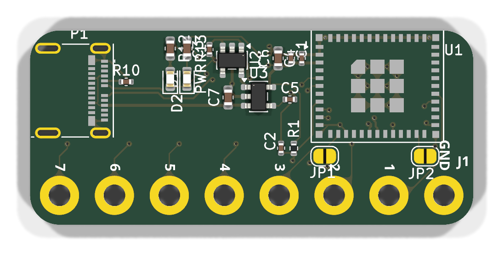
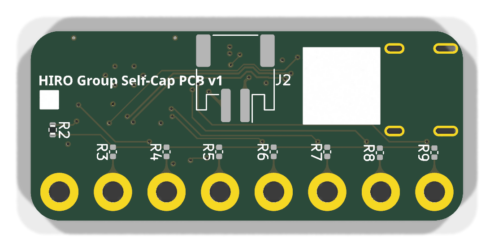
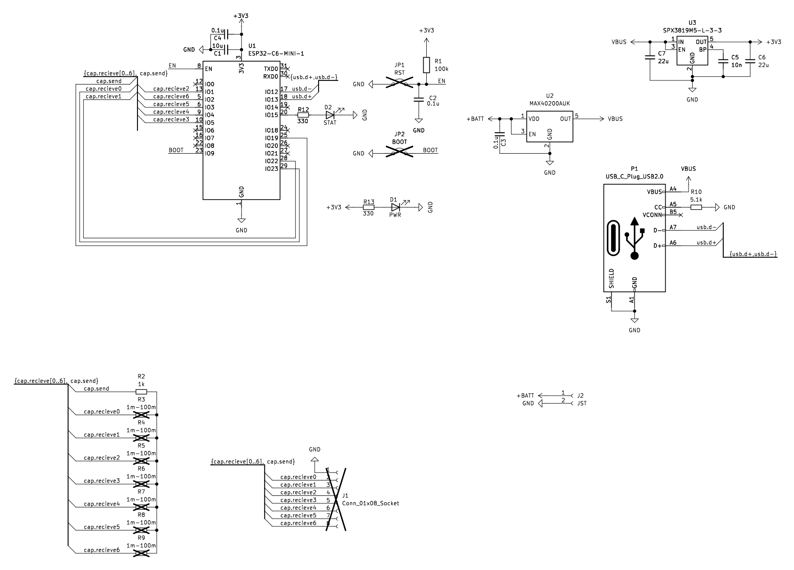

# Self-Cap

A small self-capacitance board from the HIRO Group. An ESP32-C6-MINI-1 reads seven electrode holes along one edge. Power comes from USB-C or a single-cell battery on a JST PH connector.

Open `self-cap.kicad_pro` in KiCad 9. The electrode-hole footprint lives in `self-cap-conn.pretty`. The silkscreen reads **HIRO Group Self-Cap PCB v1**.

## Board

Top. The ESP32-C6-MINI-1 lands on the right, and the USB-C receptacle is the pair of slots on the left. The module can and the connector shell are not drawn here; the footprints are.

Bottom. J2 is the battery connector and R2 (1 kΩ) is fitted. R3–R9 are left empty.

The board is 45.2 mm × 19.8 mm, four layers, 1.6 mm. The two inner layers are ground. Eight plated holes, 2.2 mm drill on a 5.6 mm pitch, run along the long edge. GND is the hole at the module end. Hole 7 is the hole at the USB end.

| Silkscreen | ESP32-C6 pin |
| --- | --- |
| GND | GND |
| 1 | IO23 |
| 2 | IO22 |
| 3 | IO1 |
| 4 | IO5 |
| 5 | IO4 |
| 6 | IO3 |
| 7 | IO2 |

Each numbered hole is already tied to that GPIO. R3–R9 are optional 0402 resistors on the bottom, one per hole, from the electrode to a common node. That node is driven by IO19 through R2 (1 kΩ). The value on the schematic is 1 MΩ–100 MΩ; fit whatever value you want in that range, or leave them off.

D1 is the power LED. It lights when the 3.3 V rail is up. D2 is the status LED on IO15, active high, through 330 Ω.

JP1 and JP2 are open solder jumpers. Bridge JP1 to hold EN low. Bridge JP2 to hold IO9 (BOOT) low for the serial download mode. R1 is a 100 kΩ pull-up on EN.

## Power

USB-C or the battery can run the board. U3 (SPX3819) makes 3.3 V from that input. J2 pin 1 is battery positive and pin 2 is ground. Use a single lithium cell.

U2 (MAX40200) is an ideal diode from the battery onto the 5 V rail, so USB voltage stays off the cell. There is no charger on this board.

The USB 2.0 pair and the 5.1 kΩ CC pulldown are wired on one side of the receptacle (A6, A7, and A5). If a cable does nothing, flip the plug.

## Having the board made

The files in `production/` match this revision of the board. Upload those, not an older export.

### Bare boards

1. Upload [`production/self-cap-gerbers.zip`](production/self-cap-gerbers.zip). It contains the four copper layers, solder mask, silkscreen, paste, the board outline, and one Excellon drill file.
2. Check that the preview shows a 4-layer board about 45.2 mm × 19.8 mm, with eight large round holes and two slots at the USB end.
3. Order it with these settings. They match the stackup in the KiCad file and a normal prototype fab (JLCPCB, PCBWay, and the usual Gerber upload forms).

| Setting | Value |
| --- | --- |
| Layers | 4 |
| Thickness | 1.6 mm |
| Material | FR-4 |
| Outer copper | 1 oz |
| Inner copper | 0.5 oz |
| Min trace / space | 0.15 mm / 0.2 mm |
| Smallest drill | 0.3 mm vias. Electrode holes are 2.2 mm. |
| Holes | All plated, including the electrode holes. The USB shell uses plated slots. |
| Surface finish | ENIG when the fab is soldering the USB-C connector and the module. HASL is fine if you are hand-soldering. |
| Soldermask / silk | Green soldermask and white silk match the pictures. Any color works. |
| Impedance control | Leave it off. The inner layers are a ground plane. |

The USB shell copper is 0.18 mm from the outline. If the quote warns about copper-to-edge clearance, accept it only when the shell pads are still complete in the preview.

### Assembled boards

Assembly is two-sided, but the bottom only needs J2 and R2. You can order top-side assembly and solder those two yourself.

1. Upload [`production/bom.csv`](production/bom.csv) and [`production/positions.csv`](production/positions.csv) with the gerber zip.
2. The BOM comments are the values. The LCSC column is the part number stored on the schematic. Open each LCSC page and confirm the value before you pay.
3. Parts left off the board on purpose, and omitted from both files: R3–R9, JP1, JP2, and J1. J1 is the hole pattern, not a connector.
4. On the placement preview, confirm every part sits on its pads. Check the module, the USB-C connector, both LEDs, and the two SOT-23-5 parts (U2, U3). Check J2 and R2 on the bottom. Fix any rotation in the preview before paying. The position file uses KiCad’s coordinates and rotation, and the Y values are negative, which is what KiCad writes and what JLCPCB’s KiCad import expects.

R10 (5.1 kΩ), R12, and R13 (330 Ω) use 0402 and 0603 lands. Order the resistor listed in the BOM.

## Design files

| File | What it is |
| --- | --- |
| `self-cap.kicad_pro` | KiCad 9 project |
| `self-cap.kicad_sch` | Schematic |
| `self-cap.kicad_pcb` | Board |
| `self-cap-conn.pretty/` | Electrode-hole footprint |
| `self-cap.step` | Board model |
| `production/self-cap-gerbers.zip` | Gerbers and drill file to upload |
| `production/bom.csv` | Assembly BOM |
| `production/positions.csv` | Pick-and-place file |

If you change the board, export a new gerber zip, drill file, BOM, and position file from that revision before ordering.
